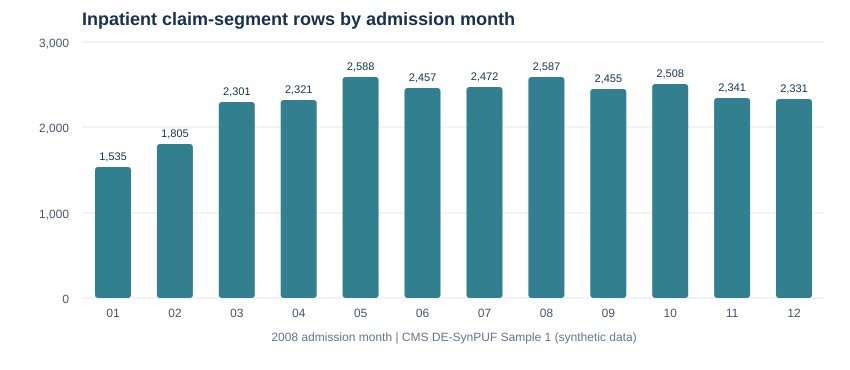

# Medicare Claims Data Quality & Utilization

**SAS · SQL (SQLite) · Python · CMS synthetic Medicare claims**

> **Portfolio project | CMS DE-SynPUF Sample 1.** Uses publicly released **synthetic**, not real-person, Medicare data. The goal is to demonstrate reproducible data preparation, SQL analytics, quality assurance, and clear reporting—not estimate actual Medicare utilization or healthcare-associated infection rates.



## At a glance

| Source / measure | Verified result |
| --- | ---: |
| 2008 beneficiary rows | **116,352** |
| Inpatient claims file rows (all years) | **66,773** |
| 2008 admission-year inpatient segment rows | **27,701** |
| Distinct claim IDs within 2008 subset | **27,682** |
| Distinct synthetic beneficiaries with a 2008 admission | **15,864** |
| Negative payment values flagged | **22** |
| Missing utilization-day values flagged | **23** |
| Average nonnegative payment per claim-segment row | **$9,323.60** |
| Average recorded utilization days (eligible rows) | **5.63** |

**[Read the complete, real-data analysis report](reports/real_cms_sample1_2008_report.md)** — includes source reconciliation, QC flags, age groups, monthly summaries, synthetic ICD-9 frequencies, limitations, and methodology.

## Project goals

1. Import **CMS Sample 1 beneficiary (2008)** and **inpatient claims (2008–2010)** data and verify the schemas and row counts.
2. Select 2008 admission-year segments to match the 2008 beneficiary snapshot.
3. Link using `DESYNPUF_ID`, preserving claim/segment granularity.
4. Flag missing values, negative payments, impossible date ordering, nonmatching beneficiaries, age anomalies, and duplicate claim/segment keys without blindly dropping rows.
5. Produce reusable SQL queries, aggregates, and a Markdown report.

## Repository guide

| Path | Purpose |
| --- | --- |
| [`sas/00_import_and_verify.sas`](sas/00_import_and_verify.sas) | Exact input filenames, online SAS Studio import, schema/row verification |
| [`sas/01_clean_and_quality_checks.sas`](sas/01_clean_and_quality_checks.sas) | Date conversion, 2008 cohort filter, beneficiary linkage, QC flags |
| [`sas/02_summary_and_export.sas`](sas/02_summary_and_export.sas) | SAS summary tables and aggregate exports |
| [`sql/01_quality_checks.sql`](sql/01_quality_checks.sql) | Source counts, exceptions, duplicate claim-segment checks |
| [`sql/02_claims_analysis.sql`](sql/02_claims_analysis.sql) | Utilization, payments, monthly and age-group reports |
| [`scripts/build_database.py`](scripts/build_database.py) | Reproducible standard-library CSV → SQLite ingestion |
| [`scripts/generate_report.py`](scripts/generate_report.py) | Rebuild aggregated CSVs, SVG chart, JSON metrics and Markdown report |
| [`tests/test_pipeline.py`](tests/test_pipeline.py) | Automated regression checks against CMS Sample 1 |
| [`outputs/`](outputs/) | **Actual**, aggregate CSVs and metrics (safe for portfolio publication) |
| [`reports/`](reports/) | Finished analysis report and chart |
| [`docs/SAS_STUDIO_STEPS.md`](docs/SAS_STUDIO_STEPS.md) | Easy SAS Studio Online guide |
| [`docs/GITHUB_PUBLISHING.md`](docs/GITHUB_PUBLISHING.md) | Publish the GitHub-ready archive safely |
| [`docs/DATA_DICTIONARY.md`](docs/DATA_DICTIONARY.md) | Field definitions, analytic grain and limitations |

## Obtain the two source datasets

Download CMS **DE1.0 Sample 1** from [the official CMS sample page](https://www.cms.gov/data-research/statistics-trends-and-reports/medicare-claims-synthetic-public-use-files/cms-2008-2010-data-entrepreneurs-synthetic-public-use-file-de-synpuf/de10-sample-1):

- `DE1_0_2008_Beneficiary_Summary_File_Sample_1.csv` (extract from Beneficiary Summary 2008 ZIP)
- `DE1_0_2008_to_2010_Inpatient_Claims_Sample_1.csv` (extract from Inpatient Claims ZIP)

Place extracted CSVs in `data/raw/` (create the folder if needed). **Source CSVs and the SQLite row-level database are excluded from Git**. This repository is self-documenting even without redistributing the large raw files. The source checksums are recorded in [`data/source_manifest.json`](data/source_manifest.json).

## Reproduce the finished report (Windows)

From the extracted project root, with Python 3.10+ installed:

```powershell
py scripts\build_database.py
py scripts\generate_report.py
py -m unittest discover -s tests -v
```

For macOS/Linux replace `py` with `python3` and `\` with `/`. **No additional Python packages are required.** SQLite is included with Python.

You can open `data/processed/medicare_claims.sqlite` in a SQLite viewer, or run the two `.sql` files against it in a SQLite client. They are written for **SQLite syntax**, not SAS PROC SQL.

## Run the SAS workflow independently

SAS Studio Online runs on a remote server. Upload the same two raw CSVs through **Server Files and Folders** and follow [`docs/SAS_STUDIO_STEPS.md`](docs/SAS_STUDIO_STEPS.md). Run the three numbered `.sas` programs in order. Only change the `raw_dir` at the top of the first file.

**Execution disclosure:** The report and checked-in metrics were **executed using Python + SQLite** against the original public CMS Sample 1 CSVs. The SAS programs are supplied as runnable source for **independent verification in SAS Studio**; they were not executed in the environment that generated this repository. The project owner separately confirmed the initial SAS import row counts.

## Methodology cautions

- **Synthetic data**: CMS says DE-SynPUF is designed for training/software development and is unsuitable for generalizable inference about actual Medicare beneficiaries.
- **Claim segments**: Repeating `CLM_ID` with a different `SEGMENT` does not by itself indicate a duplicate claim. Row-level means can be segment-weighted.
- **Date filter**: Admissions in 2007 are present in the three-year source. This report only analyzes records admitted in 2008.
- **Missingness**: We flag and preserve missing or negative values; no imputation. Means exclude ineligible values only where indicated.
- **ICD era**: Diagnostic codes are ICD-9 in this 2008 cohort, not ICD-10, and are not an HAI-identification algorithm.

## Sources and attribution

- [CMS 2008–2010 DE-SynPUF overview](https://www.cms.gov/data-research/statistics-trends-and-reports/medicare-claims-synthetic-public-use-files/cms-2008-2010-data-entrepreneurs-synthetic-public-use-file-de-synpuf)
- [CMS Sample 1 download page](https://www.cms.gov/data-research/statistics-trends-and-reports/medicare-claims-synthetic-public-use-files/cms-2008-2010-data-entrepreneurs-synthetic-public-use-file-de-synpuf/de10-sample-1)
- [CMS DE-SynPUF codebook](https://www.cms.gov/files/document/de-10-codebook.pdf-0)

*Portfolio note: The report shows an executed SQL data-quality pipeline and separately provides SAS scripts for the project owner to run and validate. Data are synthetic and publicly sourced.*
